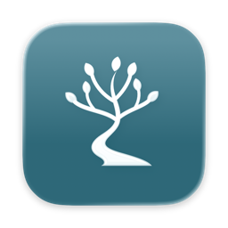
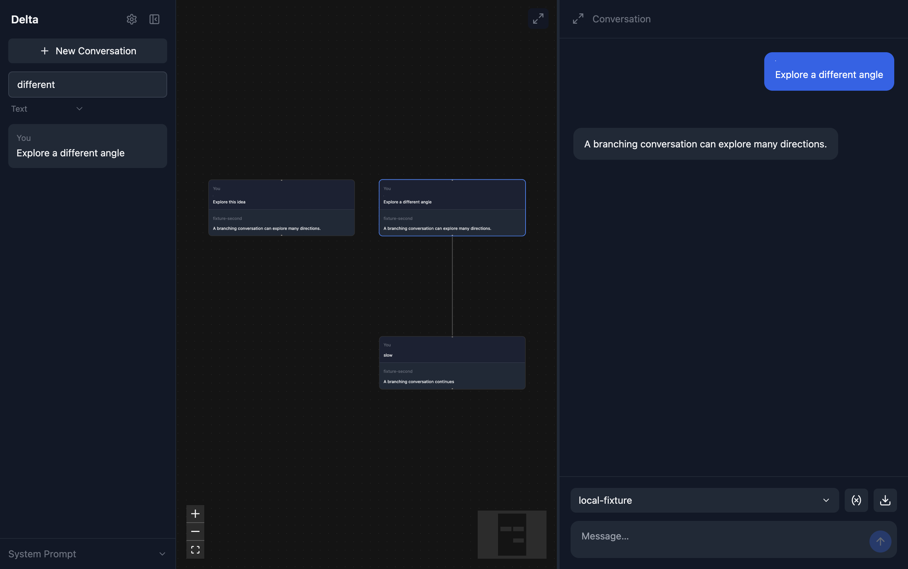

# Delta



Local-first branching conversations with AI models. Rewind a conversation, change a prompt, switch models, and explore another direction without losing the original thread.



## Install

Download a signed, notarized DMG from [GitHub Releases](https://github.com/danielcorin/Delta/releases), open it, and drag Delta to Applications. Version 0.2.0 is being prepared as a draft; its download becomes public after approval.

Apple silicon, macOS 14 or later. Intel packaging and CI are included, but an Intel download waits for native-runner verification. Windows and Linux are deferred.

## Use

1. Open Settings with ⌘,. Enable a provider and enter its API key, or enable Ollama.
2. Choose a model. The picker searches live provider catalogs; its refresh button fetches them again.
3. Send a message. Hover over a message to copy it, edit and branch, regenerate, or continue from that point.
4. Select any canvas node to follow its branch. Drag the divider to resize the canvas and chat.
5. Use Settings → Data → Export Library to back up every conversation and attached image.

OpenAI, Anthropic, Google, Ollama and OpenAI-compatible servers are supported. Use the OpenAI Compatible provider for OpenRouter, LM Studio, vLLM or another Chat Completions-compatible endpoint. Configure its API base URL, typically ending in `/v1`. Remote servers require HTTPS; localhost may use HTTP.

Model lists come from provider APIs, with cached results when offline and manual model IDs for servers that do not list models. No cloud model catalog is hardcoded. Capabilities vary by model and account. OpenAI uses the Responses API; compatible servers and Ollama use Chat Completions. Sampling settings may be ignored by reasoning models.

Paste or drop PNG, JPEG, WebP or GIF images into the composer, up to eight images at 10 MB each. Enter sends, Shift-Enter adds a line, and Stop cancels the upstream request while saving partial text. Text search is local and works without Ollama. Optional semantic search uses Ollama's `nomic-embed-text`; enable indexing in Settings → Data or index existing responses there.

## Shortcuts

Configure these in Settings → Shortcuts. `mod` means Command on macOS.

| Action | Default |
| --- | --- |
| New conversation | ⌘N |
| Settings | ⌘, |
| Search conversations | ⌘F |
| Toggle sidebar | ⌥S |
| Toggle canvas-only view | ⌥F |
| Toggle chat-only view | ⌥C |
| Focus message input | ⌥L |
| Leave input / dismiss dialog | Esc |

Standard macOS copy/paste, undo, close, quit and zoom shortcuts are provided by the app menu. Spellcheck suggestions are available by right-clicking a misspelled word.

## Data and privacy

- Conversations and images: `~/Library/Application Support/delta/delta_data/`.
- Non-secret settings: `~/.config/delta/config.json`.
- API keys: `~/Library/Application Support/delta/credentials.enc`, encrypted by Electron safeStorage using macOS Keychain. The renderer receives only whether a key is saved. Keychain may request permission when credentials are first saved or read.
- Older plaintext keys migrate automatically. Delta verifies the encrypted copy before removing the old values. Existing databases and images stay in place.
- Prompts, images and selected conversation history go to the provider you select. Optional embeddings go to the configured Ollama server. There is no telemetry.
- Full-library ZIPs contain a consistent SQLite snapshot, images and a format manifest, never credentials. Individual chat JSON and Obsidian Canvas exports are available beside the model picker.

To restore a library: quit Delta, retain a copy of the current `delta_data` folder, unzip the backup, then replace `delta_data/delta.db` and `delta_data/attachments` together. Remove old `delta.db-wal` and `delta.db-shm` sidecars only after quitting. Backups contain private conversation content; store them accordingly.

## Develop

Install [mise](https://mise.jdx.dev/) and Xcode Command Line Tools, then:

```sh
mise trust
mise install
mise exec -- npm ci
mise exec -- npm start
```

For an isolated development library, set `DELTA_HOME=/absolute/path/to/test-home`. It redirects both configuration and application data. Do not point it at another app's data.

```sh
mise exec -- npm run check          # strict types, lint, boundary tests
mise exec -- npm run package        # unsigned native app in out/
mise exec -- npm run test:app       # hidden-window Electron integration tests
mise exec -- npm run test:package   # launch the actual packaged executable
mise exec -- npm audit
```

Tests use temporary libraries and fake HTTP providers. They do not call paid APIs or read your Delta library. UI screenshots are written to `test-results/`. The package must be rebuilt after source changes before app tests.

Knex owns the existing migration history in `src/main/migrations`. Migrations run before the window opens. Keep released migrations immutable; add a new migration for schema changes. The SQLite driver and vector extension are the only native runtime dependencies; frontend code and provider SDKs are bundled.

## Release

See [docs/RELEASE.md](docs/RELEASE.md). The default release process creates verified local artifacts, then a private GitHub draft. Publication is an explicit separate command.

## Original roadmap

- [x] Versioning: 0.2.0, lockfile and release manifests.
- [x] GitHub Actions for checks, macOS builds and downloadable CI artifacts. First remote execution follows the approved source push.
- [ ] Linux and Windows testing: deferred by scope.
- [x] Configurable OpenAI-compatible server.
- [x] Provider integrations and dynamic model discovery.
- [x] Searchable model picker, provider hiding, refresh, cache and manual IDs.
- [x] Remaining TypeScript errors resolved; strict typecheck in CI.
- [x] Migration framework reviewed: retain Knex to preserve the existing migration ledger; repair broken database/admin calls.
- [x] Non-secret config under `~/.config/delta`; credentials separated into encrypted storage.
- [x] Shortcut documentation and configuration.
- [x] Build cleanup: bundle JavaScript, prune development dependencies, remove the hand-maintained dependency-copy list.
- [x] Spellcheck and native context-menu suggestions.
- [x] Full-library export UI.

The dormant automatic-summary code was removed rather than adding hidden paid requests. Existing summary rows and their migration are preserved.
